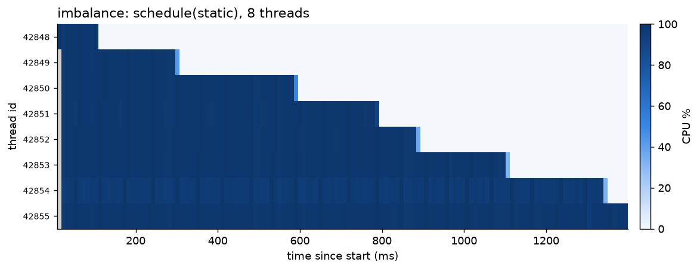
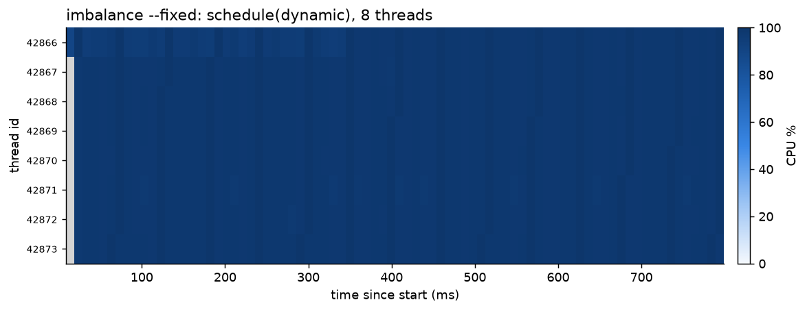

# parprof

A Linux profiler that tells you **why your multithreaded program is slow**.
Run a program under it and get per-thread scheduling stats, hardware counters,
and plain-English findings: load imbalance, lock contention, false sharing,
CPU oversubscription.

```
$ OMP_NUM_THREADS=4 parprof ./build/contention

== parprof: exited with code 0, 0.832 s wall, 2.649 s CPU ==

     TID  NAME                CPU(s)   CPU% RUNQ(ms)    VOL-CS  INVOL-CS    MIGR
   43225  contention           0.658   79.2      0.5     93595        12      19
   43226  contention           0.671   80.6      0.3     95607        10      11
   ...
hardware (user space): 5.65e+09 instructions, 5.45e+09 cycles, IPC 1.04, L1D miss 5.7%

  [lock-contention] each thread blocked 113797 times per second, which usually means
  threads queueing for a contended lock (a futex wait each time). ...
```

## Build and run

Needs Linux, CMake 3.20+, a C++20 compiler and OpenMP. No root needed.

```sh
cmake -S . -B build && cmake --build build -j
./build/parprof ./build/false_sharing            # report goes to stderr
./build/parprof --scale 1,2,4,8 ./build/false_sharing
./build/parprof --csv t.csv ./build/imbalance && python3 scripts/plot.py t.csv
./build/parprof --gpu ./build/gpu_busy           # also sample an NVIDIA GPU
ctest --test-dir build --output-on-failure       # unit + end-to-end tests
```

`plot.py` needs matplotlib (`pip install -r scripts/requirements.txt`).
`gpu_busy` is built only if the CUDA toolkit is found.

## What it detects

| Finding | Signal | Where it comes from |
|---|---|---|
| `load-imbalance` | busiest thread used ≥1.4× the average CPU time | `/proc/<pid>/task/<tid>/schedstat` |
| `lock-contention` | ≥1000 voluntary context switches per thread per second | `/proc/.../status` |
| `low-ipc` | multithreaded and < 0.5 instructions per cycle | `perf_event_open` counters |
| `cache-contention` (`--scale`) | more threads: same instructions, ≥3× the cycles | `perf_event_open` counters |
| `cpu-oversubscription` | time waiting for a CPU ≥ 25% of time running | `schedstat` run-queue wait |

Thresholds are named constants at the top of `src/analysis.cpp`, calibrated by
running each demo's buggy and fixed versions.

## How it works

1. **Launch.** `fork()`; the child blocks on a pipe. The parent attaches the
   counters, then releases the child, which calls `exec()`. A second close-on-exec
   pipe carries `errno` back if `exec()` fails (EOF means it succeeded).
2. **Counters.** `perf_event_open` with `inherit` (count new threads too),
   `enable_on_exec` (skip parprof's own setup) and `exclude_kernel` (allowed at
   the default `perf_event_paranoid=2`). Values are scaled if the kernel had to
   multiplex them.
3. **Sampling.** Every 10 ms it reads each thread's `stat` (current core),
   `status` (context switches), `schedstat` (ns running / waiting) and `sched`
   (migrations). It sleeps in `poll()` on a pidfd, so it wakes as soon as the
   program exits.
4. **Totals.** `wait4()` returns exact process CPU time; the counters are read after exit.
5. **OpenMP gotcha.** Idle OpenMP threads spin by default, so they look 100%
   busy. parprof sets `OMP_WAIT_POLICY=passive` (unless you set it) so idle
   threads sleep and CPU time shows real work.

## Demos

Each demo has a deliberate bug; `--fixed` runs the corrected version.
Numbers below are from a Ryzen 7 9700X (8 cores / 16 threads).

| Demo | Bug → fix | Buggy | Fixed | What parprof showed |
|---|---|---|---|---|
| `false_sharing` | counters on one cache line → padded to 64 B | 1.33 s | 0.05 s | IPC 0.13 vs 3.37; `--scale`: 1→16 threads took 39× the cycles for the same instructions |
| `contention` | `omp critical` per item → `reduction` | 1.73 s | 0.07 s | 55,000 blocks per thread per second |
| `imbalance` | `schedule(static)` on a triangular loop → `dynamic` | 1.40 s | 0.81 s | busiest thread 1.6–1.9× the average (8 threads) |
| `gpu_busy` | CPU spins while waiting for the GPU → `--blocking-sync` | 2.18 s CPU | 0.21 s CPU | same GPU work, 10× less host CPU |

The timeline heatmap makes imbalance visible: with `static`, threads finish one by one and sit idle.




## Limitations

- Per-thread numbers are sampled, so a thread's last ≤10 ms (or a very short-lived
  thread) can be missed. Process totals from `wait4()` are exact.
- Counters can't tell false sharing from true sharing; that needs memory addresses
  (`perf c2c`). parprof says "cache-line contention" and points at the likely cause.
- Many voluntary switches can also come from I/O, not just locks.
- GPU stats are device-wide (NVML), not just for the profiled process.

## Layout

```
src/launcher.*       fork, wait at a pipe gate, exec
src/perf_counters.*  perf_event_open hardware counters
src/procfs.*         /proc parsers
src/profiler.*       sampling loop (pidfd + poll), per-thread tracking
src/analysis.*       rules that turn measurements into findings
src/report.*         table, scaling table, CSV
src/gpu.*            NVML sampling via dlopen
demos/               buggy/fixed OpenMP programs and a CUDA driver-API program
tests/               C++ unit tests, Python end-to-end tests
scripts/plot.py      timeline heatmap
```
