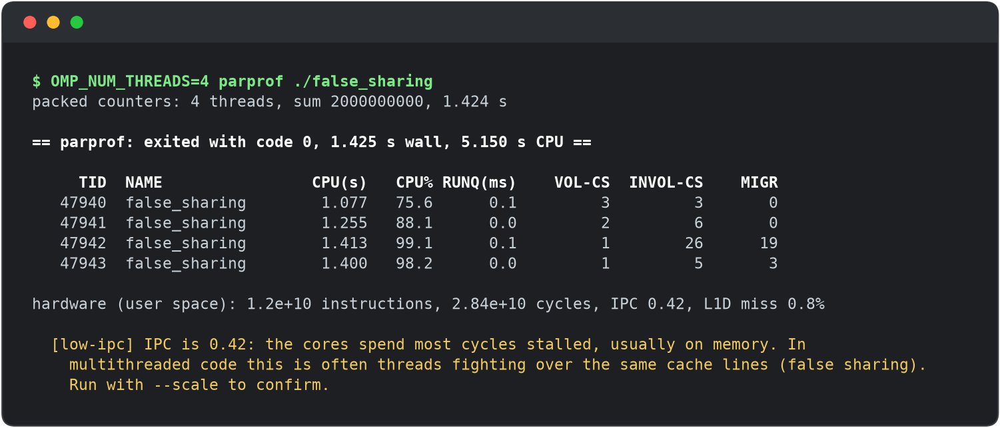
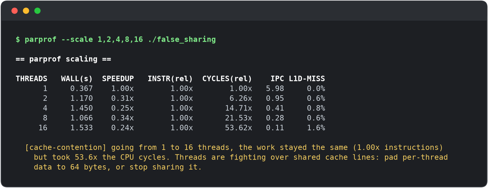

# parprof

A Linux profiler that tells you **why your multithreaded program is slow**.



## Quick start

Needs Linux, CMake 3.20+, a C++20 compiler and OpenMP. No root needed.

```sh
cmake -S . -B build && cmake --build build -j
./build/parprof ./build/false_sharing
```

| Option | What it does |
|---|---|
| `--scale 1,2,4,8` | run once per thread count and compare |
| `--csv t.csv` | save a per-thread timeline (plot with `scripts/plot.py`) |
| `--gpu` | also sample an NVIDIA GPU |

Run the tests with `ctest --test-dir build --output-on-failure`.

## What it finds

| Finding | Meaning |
|---|---|
| `load-imbalance` | one thread does most of the work while the others wait |
| `lock-contention` | threads keep blocking on a lock |
| `low-ipc` | cores are stalled, often on shared cache lines |
| `cache-contention` | more threads make the same work take more cycles (false sharing) |
| `cpu-oversubscription` | more runnable threads than cores |

`--scale` confirms false sharing: the instructions stay the same, but the cycles explode.



The timeline shows load imbalance: with `schedule(static)`, threads finish one by one and sit idle.


## Demos

`demos/` has small programs with a deliberate bug: `false_sharing`, `imbalance`,
`contention` (plain C + OpenMP), and `gpu_busy` (CUDA). Pass `--fixed` to run the corrected version
and compare the two reports.

## How it works

- **Launch:** forks the program and holds it at a pipe until the counters are attached, then lets it `exec()`.
- **Hardware counters:** `perf_event_open`, counting every thread the program creates.
- **Per-thread stats:** every 10 ms it reads `/proc/<pid>/task/<tid>/` (CPU time, run-queue wait, context switches, migrations). It waits on a pidfd, so it notices the exit immediately.
- **OpenMP:** sets `OMP_WAIT_POLICY=passive`, otherwise idle OpenMP threads spin and look 100% busy.
- **Thresholds:** named constants in `src/analysis.cpp`, calibrated on the demos.

## Limitations

- Per-thread numbers are sampled, so very short-lived threads can be missed.
- Counters can't tell false sharing from true sharing (that needs `perf c2c`).
- GPU stats are for the whole device, not just the profiled program.
